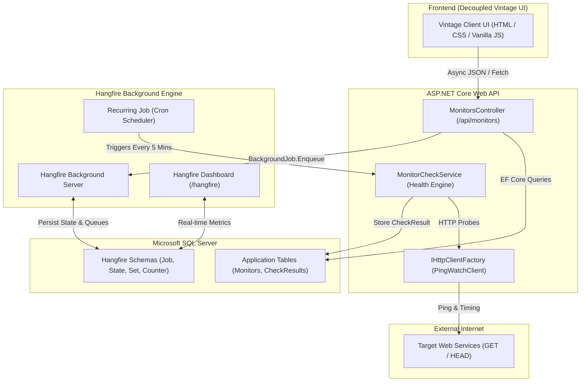

# ⏱️ PingWatch // Lightweight Website Uptime Monitor

A clean, production-grade **Website Uptime Monitor** engineered with **ASP.NET Core Web API**, **Hangfire**, **Entity Framework Core**, **SQL Server**, and a decoupled **Vintage 1980s Typewriter HTML/CSS/JS** frontend.

PingWatch is designed to demonstrate how Hangfire functions naturally in a real-world system: managing background recurring jobs, surviving application restarts with persistent storage, enforcing retry policies, and offering granular monitoring through the Hangfire Dashboard.

---

## Architecture & System Topology

PingWatch enforces a clean separation of concerns:
- **Backend**: Pure RESTful API service with Hangfire background dispatchers. No Razor views or server-side MVC rendering.
- **Frontend**: Lightweight, standalone HTML5, CSS3, and Vanilla JavaScript with a retro typewriter/telegraph aesthetic.
- **Background Orchestration**: Hangfire Server embedded in the ASP.NET Core runtime, running against SQL Server persistent tables.



---

## Hangfire Learning Pillars Demonstrated

### 1. Recurring Jobs (`RecurringJob.AddOrUpdate`)
- Uses a centralized orchestrator model: `pingwatch-check-all-monitors`.
- Periodically queries the database for active monitors (`IsActive == true`) and iterates through them without spawning unbounded cron workers.
- Default schedule: `"*/5 * * * *"` (every 5 minutes; configurable in `appsettings.json`).

### 2. Automatic Retry & Fault Tolerance
- Decorated with `[AutomaticRetry(Attempts = 3, OnAttemptsExceeded = AttemptsExceededAction.Fail)]`.
- **Key distinction**: A monitored website being down (e.g., HTTP 503 or DNS error) is recorded as a `CheckResult` with `IsSuccess = false` and does **not** fail the background job.
- Infrastructure-level failures (e.g., SQL Server connectivity loss) gracefully activate Hangfire's exponential backoff retry mechanism.

### 3. Persistent Job Storage
- Job states, recurring schedules, and execution histories are persisted in SQL Server tables (`Hangfire.*`).
- When the API process is killed (`Ctrl+C`) or restarted, Hangfire automatically resumes scheduled jobs and picks up uninterrupted without lost schedules.

### 4. Interactive Dashboard & Debugging
- Embedded at `/hangfire` via `app.UseHangfireDashboard()`.
- Allows real-time inspection of active workers, queues, succeeded/failed jobs, and enables instant **"Trigger now"** execution for manual verification.

---

## Tech Stack

| Technology | Purpose |
| :--- | :--- |
| **.NET 10 / ASP.NET Core** | High-performance REST Web API |
| **Hangfire 1.8.x** | Background job scheduler, recurring jobs, and dashboard |
| **Entity Framework Core 10** | Object-Relational Mapping (ORM) and schema migrations |
| **Microsoft SQL Server** | Relational storage for application entities and Hangfire state |
| **IHttpClientFactory** | High-performance HTTP client management with socket reuse |
| **Vanilla HTML/CSS/JS** | Decoupled vintage monochrome typewriter-style interface |

---

## Data Model & Schema

The domain uses two core entities:

### `Monitor`
Represents an enrolled target URL to be surveyed.
- `Id` (`int`, Primary Key)
- `Name` (`string`, max 200)
- `Url` (`string`, max 2000)
- `IsActive` (`bool`, default `true`)
- `CreatedAt` (`DateTime`, UTC)
- `CheckResults` (`ICollection<CheckResult>`, cascade delete)

### `CheckResult`
Represents the historical outcome of a single HTTP probe.
- `Id` (`long`, Primary Key)
- `MonitorId` (`int`, Foreign Key)
- `StatusCode` (`int?`, HTTP status code or null on timeout/DNS failure)
- `ResponseTimeMs` (`long`, roundtrip latency in milliseconds)
- `IsSuccess` (`bool`, `true` if HTTP 2xx)
- `ErrorMessage` (`string?`, exception summary if unreachable)
- `CheckedAt` (`DateTime`, UTC, indexed with `MonitorId`)

---

## REST API Endpoints

| Method | Endpoint | Description | Sample Request / Query |
| :--- | :--- | :--- | :--- |
| `GET` | `/api/monitors` | List all monitors with their latest status snapshot | None |
| `POST` | `/api/monitors` | Enroll a new site to the watchlist | `{"name":"GitHub","url":"https://github.com"}` |
| `GET` | `/api/monitors/{id}/checks` | Retrieve chronological check history | `?limit=50` (1–100) |
| `POST` | `/api/monitors/{id}/check` | Trigger an immediate manual probe | None |
| `DELETE`| `/api/monitors/{id}` | Remove a monitor and all associated history | None |

---

## Vintage Frontend Interface

The frontend (`/client`) is deliberately crafted with a **1980s retro teletype / typewriter** style:
- **Color Palette**: Warm cardboard/parchment background (`#F5F0E6`), dark typewriter ink text (`#1C1A17`), and muted stamp indicators.
- **Typography**: Monospace typewriter fonts (`Courier New`, `Courier`, `Monaco`).
- **Design Language**: Zero border-radius, crisp 2px solid outlines, sharp offset stamp shadows (`3px 3px 0px #1C1A17`).
- **Telemetry Indicators**:
  - `[● UP]` deep forest green stamp for healthy HTTP 2xx endpoints.
  - `[■ DOWN]` brick-red stamp for errors, timeouts, or 5xx codes.
  - `[PENDING]` ochre stamp for targets awaiting their initial run.
- **Interactive Modals**: Instant historical check drawer displaying timestamps, latencies, HTTP response codes, and error tracebacks.

---

## Quickstart & Setup Guide

### Prerequisites
- [.NET 10 SDK](https://dotnet.microsoft.com/) (or .NET 8+)
- [Docker Desktop](https://www.docker.com/) (or an active SQL Server instance)

### Step 1: Start SQL Server via Docker
Run the provided `docker-compose.yml` to launch SQL Server 2022:
```bash
docker compose up -d
```
*Note: SQL Server will be accessible on `localhost:1433` with password `PingWatch@2026!`.*

### Step 2: Apply Database Migrations (Optional)
The application automatically applies EF Core migrations and sets up Hangfire schemas on startup. However, you can also run migrations manually:
```bash
dotnet ef database update --project src/PingWatch.Api/PingWatch.Api.csproj
```

### Step 3: Run the Web API & Background Server
```bash
dotnet run --project src/PingWatch.Api/PingWatch.Api.csproj --urls "http://localhost:5000"
```

### Step 4: Open PingWatch in Browser
- **Vintage UI**: [http://localhost:5000/](http://localhost:5000/)
- **Hangfire Console**: [http://localhost:5000/hangfire](http://localhost:5000/hangfire)
- **OpenAPI / Swagger Specification**: [http://localhost:5000/openapi/v1.json](http://localhost:5000/openapi/v1.json)

---

## Configuration Reference (`appsettings.json`)

```json
{
  "ConnectionStrings": {
    "DefaultConnection": "Server=localhost,1433;Database=PingWatchDb;User Id=sa;Password=PingWatch@2026!;TrustServerCertificate=True;MultipleActiveResultSets=True;"
  },
  "PingWatch": {
    "CheckCronExpression": "*/5 * * * *",
    "HttpTimeoutSeconds": 10
  }
}
```

- `CheckCronExpression`: Cron expression governing recurring check runs.
- `HttpTimeoutSeconds`: Per-request timeout before an unresponsive endpoint is declared `DOWN`.

---

## Best Practices Implemented

1. **Socket Exhaustion Protection**: Uses `IHttpClientFactory` typed handler with DNS lifetime pooling and pre-configured timeout.
2. **Cancellation Token Propagation**: Cancels probe requests gracefully if the host initiates shutdown.
3. **Database Scope Isolation**: Resolves background job scopes cleanly to avoid `ObjectDisposedException` when triggering asynchronous fire-and-forget probes.
4. **Resilient Indexing**: Composite index `(MonitorId, CheckedAt DESC)` ensures `GET /api/monitors` and `GET /api/monitors/{id}/checks` execute in $O(\log n)$ time even with millions of records.
